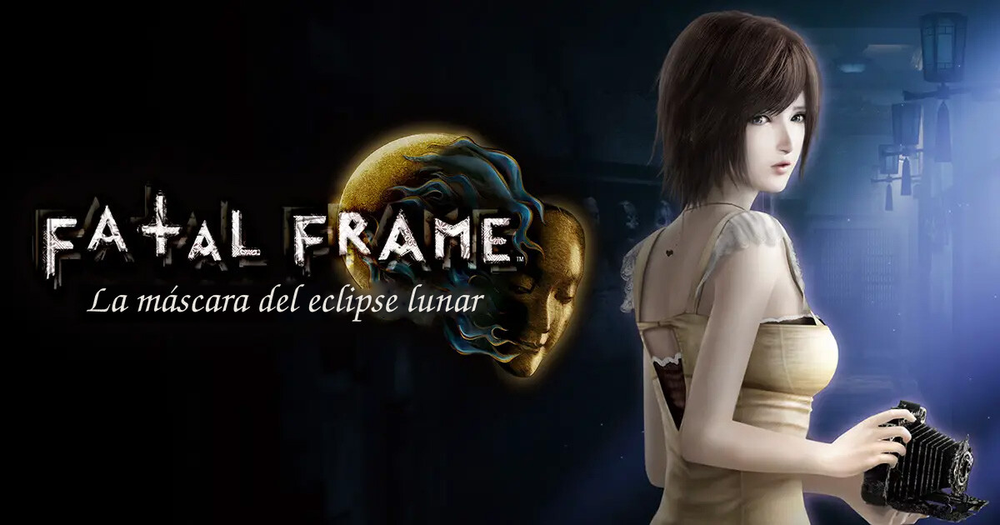
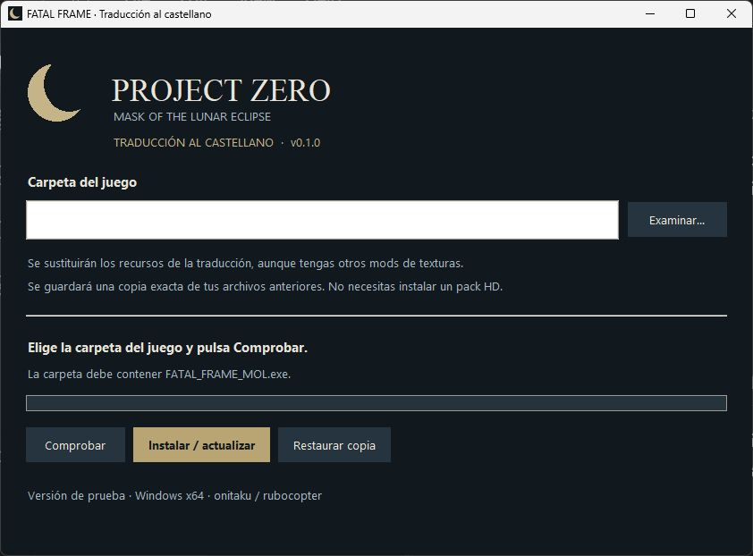

  

# Fatal Frame: La máscara del eclipse lunar — Traducción al castellano

  
  
  

  <a href="https://github.com/rubocopter/fatal-frame-mol-es-release/releases/tag/v0.1.0"><strong>Descargar traducción v0.1.0</strong></a>
  · <a href="https://github.com/rubocopter/fatal-frame-mol-es-release/issues/new/choose">Informar de un problema</a>
  · <a href="CHANGELOG.md">Historial de cambios</a>

  

Traducción no oficial al castellano de **Fatal Frame: Mask of the Lunar Eclipse** para PC, con textos y elementos gráficos adaptados a partir de la versión inglesa del juego.

**La versión v0.1.0 está en pruebas.** Los menús se han comprobado, pero todavía está pendiente revisar la historia completa jugando de principio a fin. Puedes comunicar erratas o problemas desde la pestaña [Issues](https://github.com/rubocopter/fatal-frame-mol-es-release/issues).

## Instalación rápida

Necesitas una copia del juego para **PC (Windows)**.

1. Descarga `FATAL-FRAME-MOL-ES-Setup.exe` desde la [release v0.1.0](https://github.com/rubocopter/fatal-frame-mol-es-release/releases/tag/v0.1.0).
2. Cierra el juego, ejecuta el instalador y selecciona la carpeta que contiene `FATAL_FRAME_MOL.exe`.
3. Pulsa **Comprobar** y revisa el resultado.
4. Pulsa **Instalar / actualizar** y espera a que termine. Después, inicia el juego normalmente.

No necesitas instalar Python ni ningún componente adicional para ejecutar el instalador.

> **Importante:** el parche sustituye archivos del juego. Si utilizas otros mods que modifican esos mismos archivos, sus cambios se sobrescribirán. El instalador guarda una copia de su estado anterior para poder restaurarlos.

## Qué incluye

- Traducción de textos del juego al castellano.
- Adaptación de elementos gráficos y tutoriales.
- Instalador con comprobación, instalación y restauración de copias de seguridad.

  

## Restaurar la instalación anterior

Cierra el juego, abre de nuevo el instalador y selecciona **Restaurar copia**. Se recuperará el estado de los archivos sustituidos **anterior a la última instalación del parche**, incluidos los cambios de otros mods que tuvieran entonces.

Conserva la carpeta `.fatal-frame-es-installer` creada dentro de la carpeta del juego mientras quieras disponer de esa restauración. Esta operación no equivale necesariamente a recuperar una instalación limpia de Steam.

## Compatibilidad y problemas

El instalador comprueba la estructura de archivos esperada para la versión de PC. **No requiere un paquete HD específico**, pero una actualización del juego puede necesitar una nueva versión de la traducción.

Si encuentras un problema, [abre una incidencia](https://github.com/rubocopter/fatal-frame-mol-es-release/issues/new/choose) e incluye una captura, el mensaje de error o la escena afectada. Evita adjuntar archivos del juego o datos personales.

## Créditos y derechos

Traducción y adaptación al castellano realizadas por **Onitaku**, a partir del contenido original en inglés del juego.

Proyecto fan no oficial, sin afiliación ni respaldo de los titulares de *Fatal Frame*. El juego, sus personajes, imágenes y marcas pertenecen a sus respectivos propietarios. Necesitas tu propia copia del juego para usar el parche.

Las aportaciones propias se publican con todos los derechos reservados; consulta [Derechos y reutilización](DERECHOS_Y_REUTILIZACION.md). Los avisos de terceros se incluyen en `THIRD_PARTY_NOTICES.txt` junto al instalador en [GitHub Releases](https://github.com/rubocopter/fatal-frame-mol-es-release/releases).
