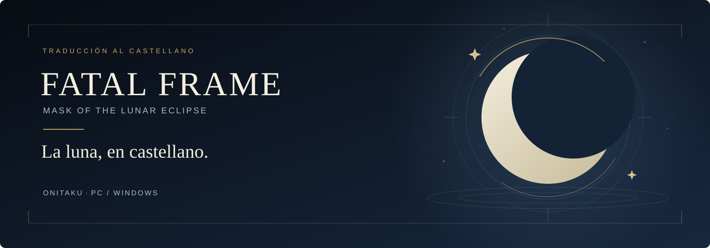

<p align="center">
  
</p>

<h1 align="center">Fatal Frame: Mask of the Lunar Eclipse · Castellano</h1>

<p align="center">
  
  
  
  
</p>

<p align="center">
  <a href="https://github.com/rubocopter/fatal-frame-mol-es-release/releases/download/v0.1.0/FATAL-FRAME-MOL-ES-Setup.exe"><strong>Descargar instalador v0.1.0</strong></a>
  · <a href="https://github.com/rubocopter/fatal-frame-mol-es-release/releases/tag/v0.1.0">Notas y archivos de la release</a>
  · <a href="https://github.com/rubocopter/fatal-frame-mol-es-release/issues">Comunicar un problema</a>
  · <a href="CHANGELOG.md">Historial de cambios</a>
</p>

<p align="center">
  <a href="https://ko-fi.com/onitaku"></a>
</p>

Una traducción al castellano de **Fatal Frame: Mask of the Lunar Eclipse** para PC, con textos y gráficos adaptados a partir del inglés original del juego. No parte de una traducción de terceros.

Este repositorio reúne la portada, la documentación y el seguimiento de incidencias. El instalador y los archivos de distribución se alojan en **GitHub Releases**.

> **v0.1.0 · Prerelease privada.** Los enlaces de descarga requieren una cuenta con acceso al repositorio privado. **Instalar / actualizar sobrescribe los 103 recursos de destino, aunque ya estén modificados por otros mods.** Cada instalación guarda una copia del estado previo exacto; al restaurar se recupera el de la última instalación, incluidos los mods. Los menús han sido validados por el autor; la revisión completa de la historia sigue pendiente.

## Antes de instalar

Necesitas tu propia copia del juego para Windows, con la estructura de recursos esperada y los archivos de destino presentes. Selecciona la carpeta que contiene `FATAL_FRAME_MOL.exe` y mantén el juego cerrado durante la comprobación, la instalación y la restauración.

**No necesitas un paquete HD concreto.** El instalador comprueba la carpeta, la presencia de los archivos, que el juego esté cerrado y la integridad del contenido del parche. No exige que tus recursos coincidan con los hashes originales del equipo de desarrollo. Las actualizaciones del juego pueden requerir una nueva versión del parche: consulta la [compatibilidad de v0.1.0](docs/releases/v0.1.0.md#compatibilidad).

## Instalación

1. Cierra el juego. Descarga `FATAL-FRAME-MOL-ES-Setup.exe` desde la [release v0.1.0](https://github.com/rubocopter/fatal-frame-mol-es-release/releases/tag/v0.1.0). Allí están también `SHA256SUMS.txt` y `THIRD_PARTY_NOTICES.txt`.
2. Abre el instalador y selecciona la carpeta que contiene **`FATAL_FRAME_MOL.exe`**.
3. Pulsa **Comprobar** y revisa el resultado.
4. Pulsa **Instalar / actualizar** y espera a que termine. Esta acción sustituye los recursos de destino, incluidos los cambios de traducción o texturas que otros mods hayan aplicado en esos mismos archivos.
5. Abre el juego por tu medio habitual cuando la instalación haya finalizado. El instalador no inicia el juego.

El ejecutable incluye Python; **no necesitas instalar Python ni dependencias por separado**. Conserva la carpeta `.fatal-frame-es-installer` que crea el instalador dentro de la carpeta del juego: contiene la copia de seguridad del estado previo exacto de los archivos sustituidos en la última instalación, incluidos los mods que tuvieran.

Para contrastar la descarga con `SHA256SUMS.txt`, puedes calcular su huella desde PowerShell en la carpeta de descarga:

```powershell
Get-FileHash -LiteralPath .\FATAL-FRAME-MOL-ES-Setup.exe -Algorithm SHA256
```

## Qué incluye

| Contenido | Alcance de v0.1.0 |
| :--- | :--- |
| Textos | **7.331 entradas traducidas** desde el inglés original en **13 FMSG**, de un conjunto de **9.030 entradas**. |
| Gráficos | **460 gráficos** repartidos en **36 KSCL y 53 KSLT**. |
| Recursos del parche | **103 recursos**, incluida la fuente. Estas cifras describen distintos niveles del contenido; no deben sumarse entre sí. |
| Tutoriales | **21 capturas de tutorial**, con **120 regiones** adaptadas. |
| Artbook | La palabra **«Artbook»** y sus gráficos permanecen en inglés por decisión del autor. Se conservan los FMSG del Artbook ya traducidos. |

El instalador es un único EXE que contiene **los 103 recursos modificados de la traducción** para sustituirlos en tu instalación y verifica la integridad del contenido mediante SHA-256. No incluye recursos originales sin modificar, el ejecutable del juego, partidas guardadas ni copias de seguridad originales.

## Vista del instalador


## Restaurar copia

1. Cierra el juego y abre el instalador.
2. Selecciona la misma carpeta que contiene `FATAL_FRAME_MOL.exe`.
3. Pulsa **Restaurar copia**.

Cada instalación guarda una copia del estado previo exacto de los archivos que sustituye. **Restaurar copia** utiliza **`.fatal-frame-es-installer`** para recuperar el estado anterior a la **última instalación**, **incluidos los cambios de otros mods**. No equivale a restaurar una instalación limpia de Steam. Esta carpeta es independiente del antiguo archivo de desarrollo `.fatal-frame-es-originals`, que no utiliza este instalador.

Si un recurso instalado por el parche ha cambiado después, la restauración comprueba sus huellas y evita sobrescribir silenciosamente ese cambio. Revisa el aviso del instalador antes de continuar. Esta protección se aplica al restaurar; **Instalar / actualizar sí sustituye intencionadamente los recursos de destino aunque estén modificados**.

## Compatibilidad y estado de revisión

- **Estructura esperada:** versión de PC con los archivos de destino presentes en sus rutas. No se exige una base HD ni hashes originales concretos para instalar.
- **Otros mods:** los cambios en los 103 recursos de destino se sobrescriben al instalar. La copia de seguridad permite recuperar su estado exacto anterior a la última instalación.
- **Actualizaciones del juego:** una estructura válida no garantiza compatibilidad con todas las revisiones. Algunas actualizaciones pueden necesitar un parche nuevo; el instalador no las distingue mediante hashes originales antiguos.
- **Validación:** el autor ha comprobado los menús. La revisión de toda la historia, los textos en contexto y el recorrido completo del juego está pendiente.
- **Incidencias:** utiliza los formularios de [instalación, traducción o compatibilidad](https://github.com/rubocopter/fatal-frame-mol-es-release/issues/new/choose). Adjunta el diagnóstico y los pasos para reproducir el problema, evitando compartir archivos del juego o datos personales.

Consulta las [notas de v0.1.0](docs/releases/v0.1.0.md) para conocer el alcance y las limitaciones de esta entrega.

## Créditos y derechos

Proyecto de **Onitaku**. Traducción y adaptación realizadas a partir del contenido original en inglés del juego.

Fatal Frame: Mask of the Lunar Eclipse y los materiales del juego pertenecen a sus respectivos titulares. Este proyecto es una traducción no oficial. Los componentes de terceros conservan sus propias licencias, recogidas en `THIRD_PARTY_NOTICES.txt` dentro de la release.

**Todos los derechos reservados sobre las aportaciones propias del autor.** Consulta [Derechos y reutilización](DERECHOS_Y_REUTILIZACION.md) antes de reutilizarlas o redistribuirlas.
